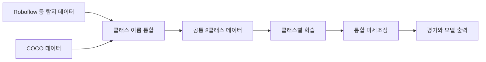

<div align="center">

# 🚶 SafeWalk Project

여러 데이터셋을 통합해 보행환경의 8개 클래스를 탐지합니다.

**기술 분류:** 컴퓨터 비전 › 딥러닝 객체 검출 › 다중 데이터셋·8클래스 통합

`Python`
`YOLO`
`Jupyter`

[빠른 시작](#quick-start) · [저장소 구성](#repository-structure) · [클래스 구성](#data-settings)

[핵심 구성](#input-processing-output)

</div>

## 🗂️ 차수와 자료 둘러보기

[**📖 전체 차수·파일별 변화 보기 →**](docs/REVISION_INDEX.md)

| 차수·자료 | 내용 | 원본 파일 | 상세·비교 |
| :--- | :--- | :--- | :--- |
| **기본 노트북** | 보행환경 8클래스·두 단계 학습 | [📁 열기](safewalk_train_v8_fixed%20%281%29.ipynb) | [📖 설명](docs/revisions/step-1.md) |
| **실험 구성과 기록** | 설정·이전 실행 노트북·에폭 지표 | [📁 열기](pbl2-main) | [📖 설명](docs/revisions/step-2.md) |


<a name="overview"></a>

## 👨‍💻 제가 구현한 부분

보행환경 8개 클래스의 데이터셋 매핑·통합, YOLO 학습·평가 노트북과 실험 기록을 정리했습니다. 이 저장소는 제가 수행한 객체 탐지 모델 개발 범위를 다룹니다.

## ✨ 주요 개발 내용

보행 안전 관련 8개 객체의 학습·평가 노트북과 실행 자료를 보관합니다.

테스트 결과로 시작 모델을 선택하는 구성입니다. 모델 선택과 독립된 성능 평가에는 별도 시험 자료가 필요합니다. 

- YOLO 학습·평가 경로를 담은 노트북입니다. 클래스 객체 검출과 실제 보행 위험 판정 성능을 구분합니다.
- 학습 데이터와 평가 설정을 노트북 셀에서 확인해야 하며, 테스트 결과를 이용한 시작 모델 선택 때문에 같은 시험 수치를 완전히 독립된 평가로 볼 수 없습니다.

**자료별 안내:** [기본](docs/versions/stage-1.md) · [전체 기록](docs/VERSIONS.md)

<a name="preview"></a>

<a name="input-processing-output"></a>

## 🔄 입력·처리·출력

| 단계 | 이 프로젝트에서 다루는 내용 |
| :--- | :--- |
| 📥 입력 | Roboflow·COCO 등 객체 영상과 라벨 |
| ⚙️ 처리 | 클래스 ID 통합, YOLOv8x 클래스별 학습과 전체 미세조정 |
| 📤 출력 | 8클래스 탐지·평가·영상 데모 |


---

<a name="introduction"></a>

## ✨ 프로젝트 소개

보행환경의 여러 객체를 하나의 분류 체계로 묶어 탐지 모델을 학습하는 프로젝트입니다.

SafeWalk는 보행환경을 구성하는 여덟 종류의 객체를 YOLO로 탐지하기 위한 학습 노트북입니다. Roboflow와 COCO 등 서로 다른 데이터의 클래스 표기를 공통 ID로 바꿔 통합하는 부분을 포함합니다.

| 기능 | 구현 내용 |
| :--- | :--- |
| 데이터 준비 | 여러 탐지 데이터셋의 다운로드·정리 |
| 클래스 통합 | 원본 라벨 이름을 공통 8클래스 ID에 매핑 |
| 학습 단계 | 클래스별 학습과 통합 미세조정 구성 |
| 장치 설정 | GPU 확인 및 메모리에 따른 배치 크기 선택 |
| 결과 확인 | 학습 기록·그래프·모델 출력 |
| 변환 경로 | 노트북의 추론·내보내기 실험 구성 |
| 영상 데모 | `SafeWalkDetector`의 웹캠·동영상·이미지 폴더 추론 |



<a name="repository-structure"></a>

## 📁 저장소 구성

```text
.
├── safewalk_train_v8_fixed (1).ipynb
├── pbl2-main/
│   ├── safewalk_train_v8_fixed (1).ipynb
│   └── safewalk_train_v8_fixed (1)_이전도커버전.ipynb
├── docs/VERSIONS.md
└── CHANGELOG.md
```

- [최상위 학습 노트북](safewalk_train_v8_fixed%20%281%29.ipynb).
- [보존된 실험 폴더](pbl2-main/).
- [버전 기록](docs/VERSIONS.md).

## 🧩 주요 기술

데이터를 준비하고 모델을 학습하는 데 Ultralytics YOLO, PyTorch, OpenCV, Roboflow, pandas, Matplotlib, PyYAML을 사용합니다. 노트북의 기본 모델은 YOLOv8x이며, GPU 메모리에 따라 배치 크기를 정하는 분기가 있습니다.

데이터셋별 `class_map`에서 비슷한 이름의 라벨을 공통 클래스로 매핑합니다. 예를 들어 보행자 표기나 계단·횡단보도의 여러 명칭을 통합하므로, 실제 다운로드한 버전의 라벨과 매핑이 일치하는지 확인해야 합니다.

<a name="quick-start"></a>

## 🚀 빠른 시작

```powershell
python -m pip install jupyterlab
python -m jupyter lab "safewalk_train_v8_fixed (1).ipynb"
```

1. 자신의 Roboflow 접근정보를 실행 환경의 `ROBOFLOW_API_KEY`에 준비합니다.
2. `PROJECT_ROOT`를 실제 실험 폴더에 맞춥니다. 원래 노트북은 `/root/pbl2-main` 경로를 사용합니다.
3. 패키지 설치·GPU 확인 셀을 읽고 실행 환경에 맞는 구성을 확인합니다.
4. 데이터셋 목록과 버전·이용 조건을 검토한 뒤 데이터 준비부터 실행합니다.
5. 학습 결과와 클래스별 지표를 확인하고 필요한 모델 출력 셀을 실행합니다.

CUDA 라이브러리 경로를 다루는 Linux 전용 셀이 있으므로 Windows 로컬 실행에서는 해당 환경 차이를 확인해야 합니다. 데이터셋과 완성 가중치는 별도로 준비합니다.

COCO 다운로드 분기는 `fiftyone.zoo`를 사용하지만 첫 설치 셀의 목록에는 `fiftyone`이 없습니다. 이 경로를 사용할 때는 별도 의존성을 준비해야 합니다. 데이터 병합·분할 셀은 기존 `merged`, `processed`, `per_class` 하위 결과를 지우고 다시 만드므로, `PROJECT_ROOT`를 전용 실험 폴더로 지정하고 이전 결과를 분리해 두세요.

<a name="data-settings"></a>

## 📊 데이터 구성과 클래스

| ID | 클래스 | 의미 |
| :--- | :--- | :--- |
| 0 | `bicycle` | 자전거 |
| 1 | `kickboard` | 킥보드 |
| 2 | `bollard` | 볼라드 |
| 3 | `car` | 자동차 |
| 4 | `motorcycle` | 오토바이 |
| 5 | `stairs` | 계단 |
| 6 | `crosswalk` | 횡단보도 |
| 7 | `people` | 보행자 |

### ⚙️ 실제 학습 설정

| 단계 | 코드 설정 |
| :--- | :--- |
| 병합 | YOLO bbox의 5개 항목 형식을 유지하고 세그멘테이션 라인을 제외 |
| 테스트 확보 | 볼라드·횡단보도 각각 `min(100, 해당 이미지 수의 15%)`를 우선 배정 |
| 나머지 분할 | 강제 테스트 배정 후 남은 이미지의 74% 학습·21% 검증·나머지 테스트 |
| Phase 1 | 클래스별 15~40 epoch, YOLOv8x, 이미지 640, AdamW |
| Phase 2 | 선택된 Phase 1 모델을 시작점으로 전체 클래스 150 epoch, `lr0=0.0005`, `patience=0` |
| 최종 평가 | `split="test"`, mAP50·mAP50-95·precision·recall |
| 추론 설정 | `conf=0.4`, `iou=0.45`, 이미지 640, 최대 탐지 50개 |
| 속도 측정 | 무작위 이미지 한 장으로 준비 추론 10회 뒤 반복 추론 100회 |

분할 셀의 제목은 7:2:1이지만 실제 비율은 위의 강제 테스트 배정과 74:21 분할에 따라 달라집니다. 테스트 이미지를 항상 100장 확보하는 것도 아닙니다. 또한 Phase 1의 테스트 평가값으로 Phase 2 시작 모델을 선택하므로, 같은 테스트셋의 최종 값에는 모델 선택의 영향이 포함됩니다.

데이터 이름 매핑에 일치 항목이 하나도 없을 때는 원본 ID와 대상 ID의 정렬 순서로 연결하는 fallback이 있습니다. 해당 경로가 쓰였는지 출력된 ID 매핑을 확인해야 합니다. 데이터 원본별 train·valid·test는 한데 모아 재분할하며, 이미지 내용의 중복 검출은 이 분할 코드에 없습니다.

`SafeWalkDetector`는 자전거·킥보드·자동차·오토바이 탐지에 주의 문구를 표시합니다. 거리를 계산하거나 충돌 위험을 예측하는 로직은 아닙니다. TensorRT 변환은 CUDA 환경에서 FP16 엔진을 생성하는 별도 단계이며, 속도 비교는 자신이 실행한 장치의 결과를 사용합니다.

노트북에는 목표 정확도와 처리속도를 설정했습니다. 실제 보행 안전을 평가하려면 장치별 처리속도와 클래스별 탐지 성능, 실제 보행 환경의 검증이 필요합니다.

<a name="troubleshooting"></a>

## 🛠️ 문제 해결

| 증상 | 확인할 내용 |
| :--- | :--- |
| Roboflow 인증 오류 | 본인의 환경변수와 해당 데이터셋 접근 권한 |
| 데이터 다운로드 실패 | 프로젝트·버전의 존재와 다운로드 조건 |
| GPU 메모리 부족 | 모델 크기·배치 크기·장치 메모리 |
| 클래스 수가 다름 | 원본 라벨과 공통 `class_map` 매핑 |
| Linux 명령 실패 | CUDA 경로 수정 셀의 운영체제 전제 |
| COCO 분기를 건너뜀 | `fiftyone` 설치와 다운로드 오류 로그 |
| 웹캠 창을 열 수 없음 | 설치 셀은 `opencv-python-headless`를 사용하므로 GUI 표시용 OpenCV 환경 필요 |
| 영상의 한글 표시가 깨짐 | `cv2.putText`의 기본 Hershey 글꼴은 한글용 Matplotlib 설정과 별개 |
| 목표보다 성능이 낮음 | 클래스 분포·분할·실제 학습 로그를 함께 확인 |

---

<div align="center">

**보행환경의 다양한 객체를 같은 기준으로 학습합니다.**

</div>


<details>
<summary>🧹 공개 자료 정리 기록</summary>

| 검수 대상 | 연결 자료 | 상세·이번 비교 |
| :--- | :--- | :--- |
| **기존 코드와 자료** | [📁 검수 자료](docs/publication-review) | [📖 정리 내용](docs/publication-review/item-1.md) · [🔎 파일 비교](docs/publication-review/공개파일변경.json) |

[🗂️ 전체 차수와 자료](docs/REVISION_INDEX.md)

</details>
